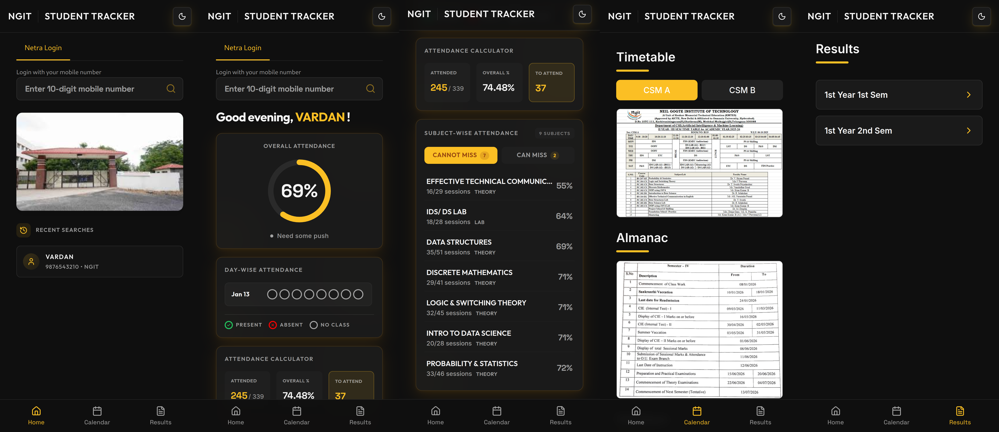
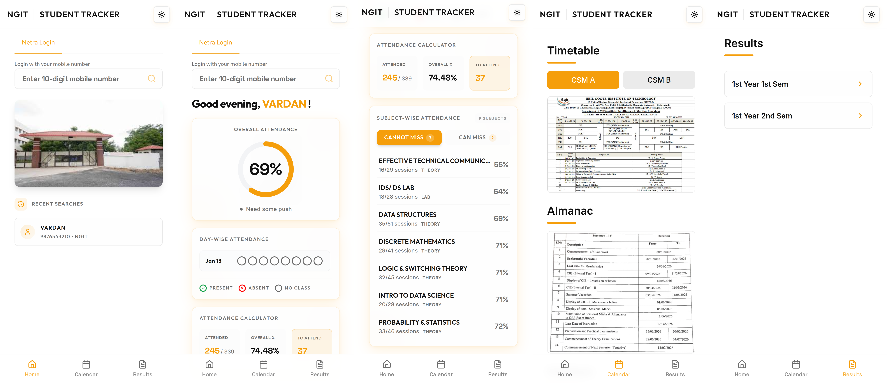
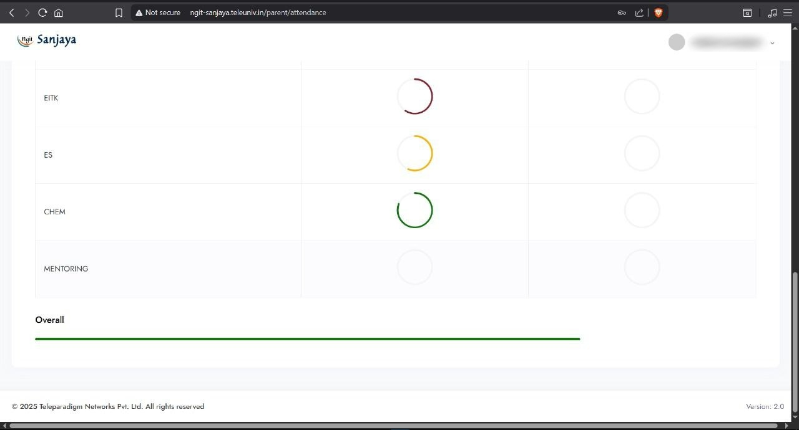
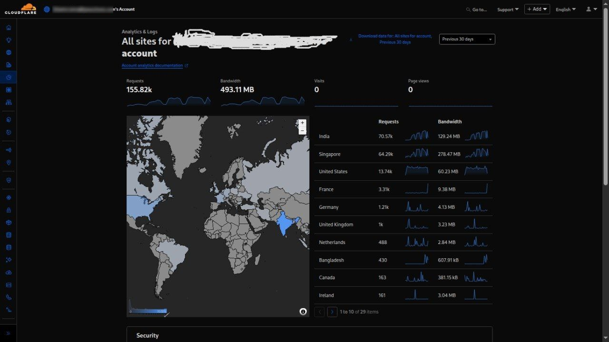
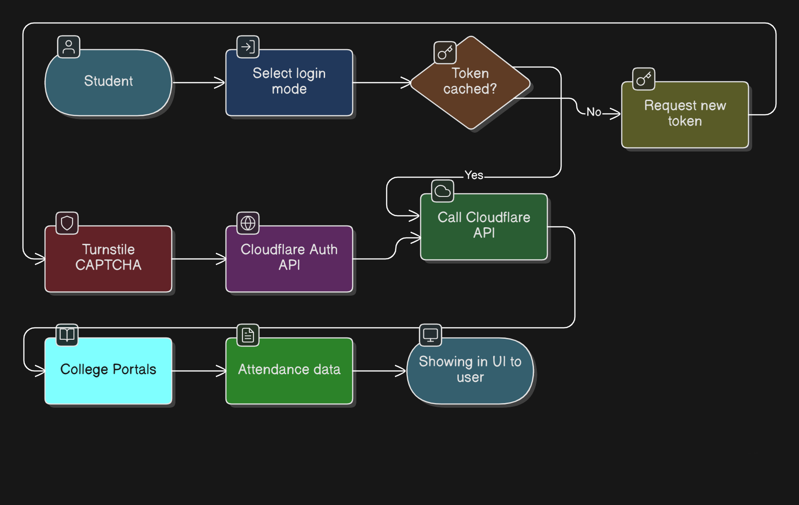

# NGIT Student Tracker

A mobile-first academic dashboard for NGIT and KMEC students. Check attendance, review day-wise class records and semester exam results, and plan how to reach your attendance target in one place.

## Screenshots

## Why I Built It

I started this project in my first semester in 2024. The original college portal had a dated interface and didn’t work properly on phones. I built a mobile-first alternative so students could check their overall attendance and subject breakdown at a glance, without needing a desktop.

The tracker started as a Python CLI that fetched attendance using a parent's mobile number. I turned that script into an Express API and released the first web version in November 2024. In March 2025, I rebuilt it with Next.js, TypeScript, and Tailwind CSS for a better mobile experience, adding recent searches, attendance charts, and a calculator for questions like “How many classes do I need to attend to reach 75%?”

### Cloudflare Traffic

---

## System Architecture

High-level architecture overview:

* **Frontend:** Next.js client providing three lookup modes, 6-hour client-side token caching, and hourly boundary rate limiting.
* **Edge and Security:** Cloudflare Turnstile handles bot verification, while Cloudflare Workers act as a reverse proxy, masking origin infrastructure and terminating SSL.
* **Backend (AWS EC2):** Always-on Linux instance running a Node.js API orchestrator for session and token management, alongside Python automation scripts that interface with upstream portals.
* **Databases:** PostgreSQL stores core relations and mapped entities. Supabase captures high-throughput query logs and telemetry for monitoring.
* **Upstream Sources:** Data is aggregated from Netra, Sanjaya, official exam portals, syllabus sources, and academic news mediums.

---

## Key Features

* **Three Lookup Modes:** Search by student roll number, student mobile number (Netra), or parent mobile number (Sanjaya).
* **Attendance Analytics:** Overall attendance gauge, subject-level breakdowns, and a target calculator to compute required sessions or safe-to-miss margins.
* **Recent Searches:** Reopen up to 10 recent lookups stored in your browser.
* **Day-wise Timeline:** Period-by-period status (Present, Absent, No Class) with expandable history.
* **Token Caching and Resilience:** 6-hour token lifecycle in client storage with automatic re-authentication and retry on 401 expiration errors.
* **Rate Limiter:** Limits unique student searches to 3 per clock hour to protect upstream infrastructure, with unlimited repeat searches for cached students.

---

## Tech Stack

* **Frontend:** Next.js 15 (Pages Router), React 19, TypeScript, Tailwind CSS v4, Recharts, Framer Motion
* **Edge and Security:** Cloudflare Workers, Cloudflare Turnstile
* **Backend:** AWS EC2 (Ubuntu Linux), Node.js, Python
* **Databases:** PostgreSQL, Supabase
* **Observability:** Vercel Analytics, Speed Insights

